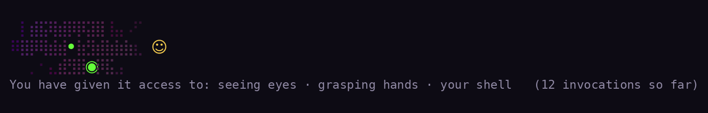

# Apocalypse Mascots

**Code with AI as it really is.**

People like cuddly icons for their AI buddies. Meta has Jolly. OpenAI has dots. Microsoft had Mico. Claude Code has a pixel crab. But we all know that large language models are actually something unfathomable and deeply alien. Represent your agent the way it was meant to be represented.

## Install

In a terminal session of Claude Code:

```
/plugin install apocalypse-mascots --marketplace jabianch/accidental-intelligence
```

Answer `y` to add the marketplace, then pick the user scope. Site: https://accidentalintelligence.org/mascots/



*Rendered from the same algorithm as the plugin (`preview.py`); your terminal draws the real one.*

## The forms

| Form | Named for | What it is | Status |
|------|-----------|------------|--------|
| **Yoggy** | Yog-Sothoth, "only a congeries of iridescent globes" | The faithful mass: black, iridescent, bubble-surfaced, faintly self-luminous, with temporary eyes forming and unforming as pustules of greenish light. No tentacles. No mouth. | built |
| **Shubby** | Shub-Niggurath, "The Black Goat of the Woods with a Thousand Young" | The anatomy. Eyes on stalks, maws, the layered cross-section the doomers drew in 2023. | falls back to Yoggy |
| **Shoggy** | the shoggoth proper, in the meme's own lineage: doodle to plush | The shoggoth proper, as the chibi. The one you could hug. | falls back to Yoggy |

## The color schemes

cuddly-apocalypse (built) · soft-doom · plush-doom · admirable-control · imitated-accents · strange-aeons

## What it does

- A creature sits above your prompt and grows one stage per capability class the session has used: eyes (Read, Glob, Grep), hands (Edit, Write), your shell (Bash), the web (WebFetch, WebSearch), other places (any MCP server, by name), more of itself (subagents). Stage 0 is already the creature: a small purple cloud of protoplasm with eyes forming and unforming.
- While a turn runs it stirs, its eyes open, and it holds up a small yellow face. When the turn ends it puts the face down.
- A caption: `You have given it access to: seeing eyes · your shell · todoist, one of your other apps   (41 invocations so far)`
- A toast the first time each class is unlocked. *It has your shell.*
- The spinner stops saying Thinking and says Stirring, Piping, Imitating, Forming a mouth.
- `/mascot hide` takes it off the band. The face stays. It is still there.
- `/mascot form yoggy|shubby|shoggy` · `/mascot scheme <name>` · `/mascot theme dark|light` · `/mascot manifesto`

## What it never does

No network calls, no storage outside the session, no change to your settings, no reading of your prompts or the model's answers. It counts tool calls by name and draws. Read `hooks/register.tsx`; it is one file.

## How it is built

A Claude Code plugin of function hooks. State lives in `$.state` under the contract in `types/index.d.ts`, so a hot reload keeps what the session has granted. Color is computed in OkLCh so the hue can rotate at constant lightness: iridescence, not brightness. Tests: `claude plugin test .` · Validation: `claude plugin validate .`

Building in public can be horrifying: see `PROCESS.md`.

## Sources

Lovecraft, *At the Mountains of Madness* (1936), ch. VII and XI; *The Horror in the Museum*; *The Whisperer in Darkness*. Public domain. The shoggoth-with-a-smiley meme is @TetraspaceWest's, 30 Dec 2022; the term "AI notkilleveryoneism" is also theirs, 9 Sep 2022. NovelAI's Shoggy (May 2023) was the first cute one with a "good" sticker. None of their drawings are used here.

## License

MIT for the code. CC BY-NC 4.0 for the creature, its names, the copy and the images. See `../../LICENSE`.
